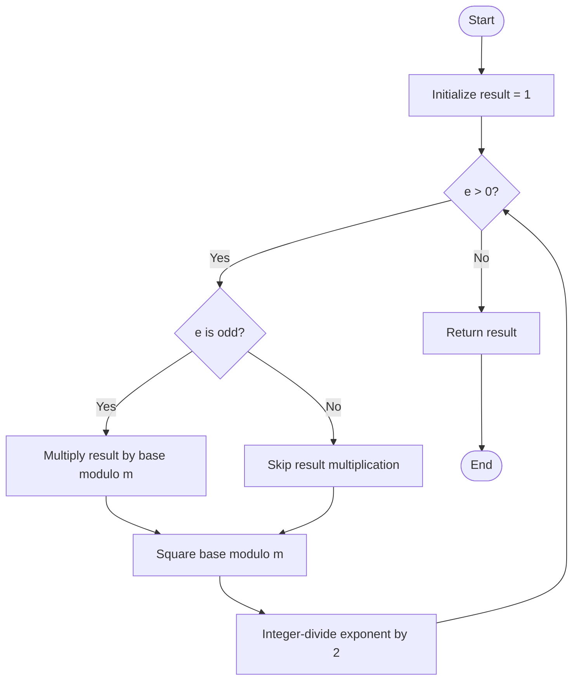
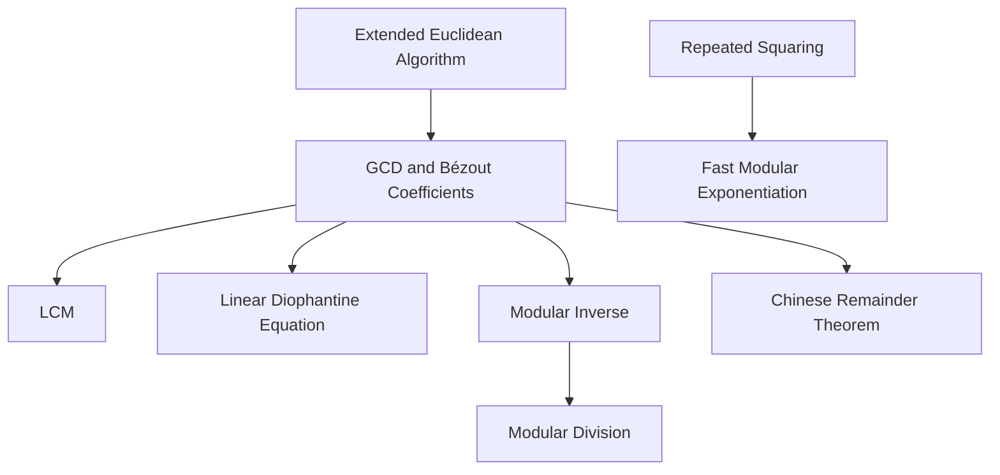

# Name : Farhad Ali
# ID: IT23035


# Day 1 Assignment — Number Theory & Modular Arithmetic

> **Notebook:** `Day 1 Assignment.ipynb`  
> **Language:** Python 3  
> **Environment:** Jupyter Notebook / JupyterLab  
> **Topics:** Extended Euclidean Algorithm, GCD, LCM, Diophantine Equations, Modular Inverse, Fast Modular Exponentiation, and Chinese Remainder Theorem.

---

## Table of Contents

1. [Project Overview](#1-project-overview)
2. [Learning Objectives](#2-learning-objectives)
3. [Mathematical Foundations](#3-mathematical-foundations)
4. [Assignment Problems](#4-assignment-problems)
   - [Problem 1 — Extended Euclidean Algorithm](#problem-1--extended-euclidean-algorithm)
   - [Problem 2 — Least Common Multiple](#problem-2--least-common-multiple)
   - [Problem 3 — Linear Diophantine Equation](#problem-3--linear-diophantine-equation)
   - [Problem 4 — Modular Inverse and Modular Division](#problem-4--modular-inverse-and-modular-division)
   - [Problem 5 — Fast Modular Exponentiation](#problem-5--fast-modular-exponentiation)
   - [Problem 6 — Chinese Remainder Theorem](#problem-6--chinese-remainder-theorem)
5. [Algorithm Workflow](#5-algorithm-workflow)
6. [Notebook Tests and Expected Examples](#6-notebook-tests-and-expected-examples)
7. [Project Structure](#7-project-structure)
8. [Requirements and Setup](#8-requirements-and-setup)
9. [How to Run](#9-how-to-run)
10. [Important Assignment Notes](#10-important-assignment-notes)
11. [References](#11-references)

---

## 1. Project Overview

This assignment explores important algorithms from **elementary number theory** and **modular arithmetic** through Python programming.

The notebook contains six problems. They are connected: the Extended Euclidean Algorithm provides the mathematical foundation for several later tasks, including solving linear Diophantine equations, calculating modular inverses, and constructing a solution using the Chinese Remainder Theorem.

The goal is not only to obtain the correct numerical result, but also to understand why each algorithm works and how to implement it efficiently.

## 2. Learning Objectives

After completing the notebook, you should be able to:

- Calculate the Greatest Common Divisor (GCD) of two integers.
- Find Bézout coefficients using the Extended Euclidean Algorithm.
- Calculate the Least Common Multiple (LCM) efficiently.
- Solve linear Diophantine equations of the form `ax + by = c`.
- Find a multiplicative inverse modulo an integer.
- Perform modular division when the inverse exists.
- Calculate large modular powers using repeated squaring.
- Apply the Chinese Remainder Theorem to solve simultaneous congruences.
- Translate mathematical procedures into tested Python functions.

---

## 3. Mathematical Foundations

### 3.1 Greatest Common Divisor (GCD)

The GCD of two integers is the largest positive integer that divides both numbers without leaving a remainder.

For example:

\[
\gcd(27,15)=3
\]

The Euclidean Algorithm uses the identity:

\[
\gcd(a,b)=\gcd(b,a\bmod b)
\]

This reduces the size of the problem at every step until the remainder becomes zero.

### 3.2 Bézout's Identity

Bézout's Identity states that for integers \(a\) and \(b\), there exist integers \(x\) and \(y\) such that:

\[
\boxed{\gcd(a,b)=ax+by}
\]

The Extended Euclidean Algorithm finds the values \(x\) and \(y\), not just the GCD.

### 3.3 Least Common Multiple (LCM)

The LCM is the smallest positive integer divisible by both input integers.

The relationship between GCD and LCM is:

\[
\boxed{\operatorname{lcm}(a,b)=\frac{|a\cdot b|}{\gcd(a,b)}}
\]

For positive integers, dividing before multiplying can help reduce the chance of unnecessarily large intermediate values:

\[
\operatorname{lcm}(a,b)=\left(\frac{a}{\gcd(a,b)}\right)b
\]

### 3.4 Modular Arithmetic

The expression

\[
a\equiv b\pmod n
\]

means that \(a\) and \(b\) have the same remainder when divided by \(n\). Equivalently:

\[
n\mid(a-b)
\]

For example:

\[
17\equiv 5\pmod {12}
\]

because both 17 and 5 leave remainder 5 when divided by 12.

---

## 4. Assignment Problems

### Problem 1 — Extended Euclidean Algorithm

**Marks:** 3

**Task:** Implement `extended_gcd(a, b)` to return three values:

\[
(d,x,y)
\]

where:

\[
d=\gcd(a,b)
\]

and:

\[
\boxed{d=ax+by}
\]

**Input condition in the notebook:**

\[
a\ge b\ge 0,\qquad a+b>0
\]

#### How it works

The ordinary Euclidean Algorithm repeatedly applies:

\[
a=q b+r
\]

where \(q\) is the quotient and \(r=a\bmod b\) is the remainder.

The extended version also tracks how each remainder can be expressed as a linear combination of the original inputs.

#### Example

For \(a=27\) and \(b=15\):

\[
27=1(15)+12
\]
\[
15=1(12)+3
\]
\[
12=4(3)+0
\]

Therefore:

\[
\gcd(27,15)=3
\]

Back-substitution gives:

\[
3=15-12
\]
\[
3=15-(27-15)
\]
\[
\boxed{3=2(15)-1(27)}
\]

So one valid result is:

\[
(d,x,y)=(3,-1,2)
\]

#### Python illustration

```python
def gcd_euclidean(a, b):
    while b != 0:
        a, b = b, a % b
    return a

print(gcd_euclidean(27, 15))  # 3
```

The assignment requires the **extended** version, which must also return the coefficients `x` and `y`.

---

### Problem 2 — Least Common Multiple (LCM)

**Marks:** 1

**Task:** Implement:

```python
def lcm(a, b):
    ...
```

The function should return the LCM of two positive integers.

#### Mathematical formula

\[
\boxed{\operatorname{lcm}(a,b)=\frac{a\cdot b}{\gcd(a,b)}}
\]

#### Worked example

Find the LCM of 9 and 3.

\[
\gcd(9,3)=3
\]

\[
\operatorname{lcm}(9,3)=\frac{9\times3}{3}=9
\]

#### Python illustration

```python
def lcm_using_gcd(a, b):
    return (a // gcd_euclidean(a, b)) * b

print(lcm_using_gcd(9, 3))    # 9
print(lcm_using_gcd(17, 37))  # 629
```

**Why use GCD?** The formula avoids checking multiples one by one and provides an efficient way to calculate the LCM.

---

### Problem 3 — Linear Diophantine Equation

**Marks:** 3

**Task:** Implement:

```python
def diophantine(a, b, c):
    ...
```

Find integers \(x\) and \(y\) satisfying:

\[
\boxed{ax+by=c}
\]

The notebook states that \(a>0\), \(b>0\), and a solution is guaranteed to exist for the supplied inputs.

#### Existence condition

A linear Diophantine equation

\[
ax+by=c
\]

has an integer solution if and only if:

\[
\boxed{\gcd(a,b)\mid c}
\]

Let \(d=\gcd(a,b)\). The Extended Euclidean Algorithm gives:

\[
ax_0+by_0=d
\]

If \(d\mid c\), multiply both coefficients by \(c/d\):

\[
a\left(x_0\frac{c}{d}\right)+
b\left(y_0\frac{c}{d}\right)=c
\]

Thus, one solution is:

\[
\boxed{x=x_0\frac{c}{d},\qquad y=y_0\frac{c}{d}}
\]

#### Worked example

Solve:

\[
34x+51y=170
\]

First:

\[
\gcd(34,51)=17
\]

Since \(17\mid170\), an integer solution exists.

One valid solution is:

\[
\boxed{x=5,\quad y=0}
\]

Verification:

\[
34(5)+51(0)=170
\]

#### Python illustration

```python
# The coefficients (x0, y0) come from:
# extended_gcd(a, b) -> (d, x0, y0)

# If d divides c:
# x = x0 * (c // d)
# y = y0 * (c // d)
```

The notebook's function should use the `extended_gcd` function from Problem 1.

---

### Problem 4 — Modular Inverse and Modular Division

**Marks:** 4

**Task:** Implement `modInverse(a, n)` and use the provided `divide(b, a, n)` function.

The notebook assumes:

\[
\gcd(a,n)=1,\qquad n>1
\]

#### What is a modular inverse?

The multiplicative inverse of \(a\) modulo \(n\) is an integer \(a^{-1}\) satisfying:

\[
\boxed{a\cdot a^{-1}\equiv1\pmod n}
\]

An inverse exists exactly when:

\[
\boxed{\gcd(a,n)=1}
\]

By Bézout's Identity, the Extended Euclidean Algorithm finds integers \(x,y\) such that:

\[
ax+ny=1
\]

Taking both sides modulo \(n\):

\[
ax\equiv1\pmod n
\]

Therefore:

\[
\boxed{a^{-1}\equiv x\pmod n}
\]

To return the standard non-negative representative, use \(x\bmod n\).

#### Modular division

Ordinary division is not directly used in modular arithmetic. Instead:

\[
\frac{b}{a}\pmod n
\]

is calculated by multiplying \(b\) by the modular inverse of \(a\):

\[
\boxed{x\equiv b\cdot a^{-1}\pmod n}
\]

#### Worked example

Find the result of dividing 9 by 5 modulo 13.

First, find the inverse of 5 modulo 13:

\[
5\times8=40\equiv1\pmod {13}
\]

So:

\[
5^{-1}\equiv8\pmod {13}
\]

Then:

\[
x\equiv9\times8\pmod {13}
\]

\[
x\equiv72\pmod {13}
\]

\[
\boxed{x=7}
\]

Check:

\[
5\times7=35\equiv9\pmod {13}
\]

#### Python illustration

```python
def modular_division(b, a, n, inverse):
    a_inverse = inverse(a, n)
    return (b * a_inverse) % n
```

The notebook already provides the `divide` function structure. Your main task is to implement `modInverse(a, n)` correctly.

---

### Problem 5 — Fast Modular Exponentiation

**Marks:** 3

**Task:** Implement:

```python
def FastModularExponentiation(b, e, m):
    ...
```

Calculate:

\[
\boxed{b^e\bmod m}
\]

The assignment asks for an efficient method using approximately:

\[
2\log_2(e)
\]

modular multiplications. Python's built-in exponentiation function is not allowed for this implementation.

#### Core idea: Exponentiation by Squaring

Instead of multiplying \(b\) by itself \(e\) times, repeatedly square the base and reduce the result modulo \(m\).

The key identities are:

For an even exponent:

\[
b^e=(b^{e/2})^2
\]

For an odd exponent:

\[
b^e=b\cdot b^{e-1}
\]

At every stage, modular reduction keeps the intermediate values manageable.

#### Algorithm flow



#### Python illustration

```python
def fast_power_example(base, exponent, modulus):
    result = 1
    base = base % modulus

    while exponent > 0:
        if exponent % 2 == 1:
            result = (result * base) % modulus

        base = (base * base) % modulus
        exponent //= 2

    return result
```

#### Example

Calculate:

\[
4^5\bmod3
\]

Since:

\[
4\equiv1\pmod3
\]

we get:

\[
4^5\equiv1^5\equiv\boxed{1}\pmod3
\]

#### Complexity

- **Time complexity:** \(O(\log e)\)
- **Space complexity:** \(O(1)\) for the iterative method.

This is much more efficient than performing \(e\) separate multiplications.

---

### Problem 6 — Chinese Remainder Theorem (CRT)

**Marks:** 1

**Task:** Implement:

```python
def ChineseRemainderTheorem(n1, r1, n2, r2):
    ...
```

The notebook specifies that:

- \(n_1\) and \(n_2\) are distinct coprime integers.
- \(n_1>n_2\).
- \(0\le r_1<n_1\).
- \(0\le r_2<n_2\).

Find an integer \(r\) such that:

\[
0\le r<n_1n_2
\]

and:

\[
\boxed{r\equiv r_1\pmod {n_1}}
\]

\[
\boxed{r\equiv r_2\pmod {n_2}}
\]

#### What does CRT do?

The Chinese Remainder Theorem states that when the moduli are pairwise coprime, a system of congruences has a unique solution modulo the product of the moduli.

For two coprime moduli, the solution can be constructed using the Extended Euclidean Algorithm.

Since:

\[
\gcd(n_1,n_2)=1
\]

there exist integers \(x,y\) such that:

\[
n_1x+n_2y=1
\]

A valid construction is:

\[
\boxed{r=(r_1n_2y+r_2n_1x)\bmod(n_1n_2)}
\]

The result is reduced modulo \(n_1n_2\) so that:

\[
0\le r<n_1n_2
\]

#### Worked example

Solve:

\[
r\equiv7\pmod {13}
\]

\[
r\equiv5\pmod6
\]

The notebook includes this test case:

```python
ChineseRemainderTheorem(13, 7, 6, 5)  # Expected: 59
```

Check the result:

\[
59\bmod13=7
\]

\[
59\bmod6=5
\]

Therefore:

\[
\boxed{r=59}
\]

#### Python illustration

```python
# Given:
# n1*x + n2*y = 1
# (d, x, y) = extended_gcd(n1, n2)
#
# If d == 1:
# r = (r1*n2*y + r2*n1*x) % (n1*n2)
```

The CRT function in the notebook is designed to reuse the `extended_gcd` implementation from Problem 1.

---

## 5. Algorithm Workflow

The six problems are connected through a shared mathematical foundation.



**Dependency note:** Problems 3, 4, and 6 reuse the Extended Euclidean Algorithm. Problem 2 uses the GCD. Problem 5 is based on repeated squaring.

---

## 6. Notebook Tests and Expected Examples

The original notebook contains these sample calls and assertions:

| Problem | Notebook test | Expected result |
|---|---|---|
| Extended GCD | `extended_gcd(8, 4)` | `(4, 0, 1)` is one valid coefficient result |
| Extended GCD | `extended_gcd(27, 15)` | `(3, -1, 2)` is one valid coefficient result |
| LCM | `lcm(9, 3)` | `9` |
| LCM | `lcm(17, 37)` | `629` |
| Diophantine | `diophantine(34, 51, 170)` | Any valid integer pair |
| Diophantine | `diophantine(91, 117, 65)` | Any valid integer pair |
| Modular division | `divide(9, 5, 3)` | `0` |
| Modular division | `divide(223, 67, 54)` | `31` |
| Fast modular exponentiation | `FastModularExponentiation(4, 5, 3)` | `1` |
| CRT | `ChineseRemainderTheorem(13, 7, 6, 5)` | `59` |
| CRT | `ChineseRemainderTheorem(28, 20, 19, 3)` | `440` |

> **Note:** For Extended GCD and Diophantine equations, more than one valid coefficient pair may exist. The important requirement is that the returned values satisfy the mathematical identities and the notebook's assertions.

### Useful verification identities

```python
# Extended GCD:
assert d == a * x + b * y

# LCM:
assert (result % a == 0) and (result % b == 0)

# Diophantine equation:
assert a * x + b * y == c

# Modular inverse:
assert (a * a_inverse) % n == 1

# Modular division:
assert (a * result) % n == b % n

# Fast modular exponentiation:
assert result == pow(b, e, m)  # Use only for testing, not in the implementation.

# Chinese Remainder Theorem:
assert result % n1 == r1
assert result % n2 == r2
```

The `pow(b, e, m)` expression above is shown only as a convenient independent test in Python. The assignment explicitly prohibits using built-in exponentiation in the implementation of Problem 5.

---

## 7. Project Structure

```text
Day-1-Assignment/
│
├── Day 1 Assignment.ipynb
└── README.md
```

- **`Day 1 Assignment.ipynb`** — The original Jupyter Notebook containing the six problem statements, function templates, and test cells.
- **`README.md`** — Project documentation, mathematical explanations, algorithm flowcharts, and Python illustrations.

---

## 8. Requirements and Setup

### Software requirements

- Python 3
- Jupyter Notebook or JupyterLab

The notebook uses standard Python functionality. No third-party package is required for the algorithms described in the assignment.

### Install Jupyter

```bash
pip install notebook
```

Or install JupyterLab:

```bash
pip install jupyterlab
```

---

## 9. How to Run

1. Clone or download the repository.
2. Open a terminal in the project folder.
3. Start Jupyter Notebook:

   ```bash
   jupyter notebook
   ```

   Or start JupyterLab:

   ```bash
   jupyter lab
   ```

4. Open `Day 1 Assignment.ipynb`.
5. Read each problem statement carefully.
6. Write your implementation in the cells marked `YOUR CODE HERE`.
7. Run the cells in order.
8. Check the provided assertions and test cases.

---

## 10. Important Assignment Notes

- The notebook is an **assignment template**, not a completed solution.
- Several function bodies initially contain `YOUR CODE HERE` and `NotImplementedError()`.
- Do not delete or modify the provided assertions. The notebook explicitly warns that removing assertions can result in zero marks for the relevant problem.
- Implement code only in the designated solution areas.
- Run the Extended Euclidean Algorithm cell before running dependent problems.
- A valid mathematical result matters more than matching one particular pair of Bézout coefficients.
- The Python illustrations in this README are learning references; follow the exact function signatures and restrictions in the notebook.

### Mark distribution

| Problem | Topic | Marks |
|---|---|---:|
| 1 | Extended Euclidean Algorithm | 3 |
| 2 | Least Common Multiple | 1 |
| 3 | Linear Diophantine Equation | 3 |
| 4 | Modular Inverse and Division | 4 |
| 5 | Fast Modular Exponentiation | 3 |
| 6 | Chinese Remainder Theorem | 1 |
| **Total** | | **15** |

---

## 11. References

- [Euclidean Algorithm — Wikipedia](https://en.wikipedia.org/wiki/Euclidean_algorithm)
- [Extended Euclidean Algorithm — Wikipedia](https://en.wikipedia.org/wiki/Extended_Euclidean_algorithm)
- [Diophantine Equation — Wikipedia](https://en.wikipedia.org/wiki/Diophantine_equation)
- [Modular Arithmetic — Wikipedia](https://en.wikipedia.org/wiki/Modular_arithmetic)
- [Modular Multiplicative Inverse — Wikipedia](https://en.wikipedia.org/wiki/Modular_multiplicative_inverse)
- [Exponentiation by Squaring — Wikipedia](https://en.wikipedia.org/wiki/Exponentiation_by_squaring)
- [Chinese Remainder Theorem — Wikipedia](https://en.wikipedia.org/wiki/Chinese_remainder_theorem)

---

**End of README**
