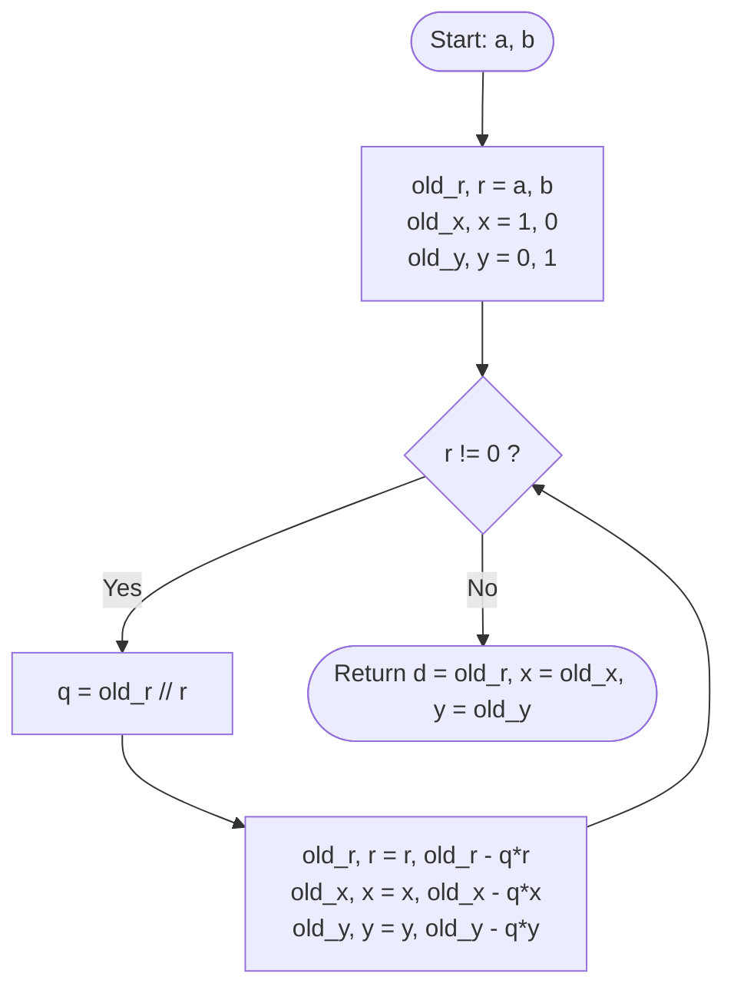
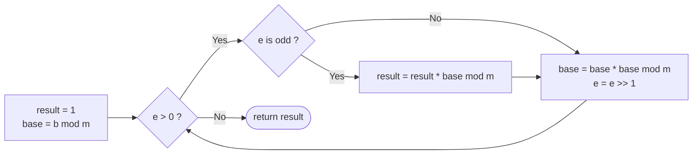
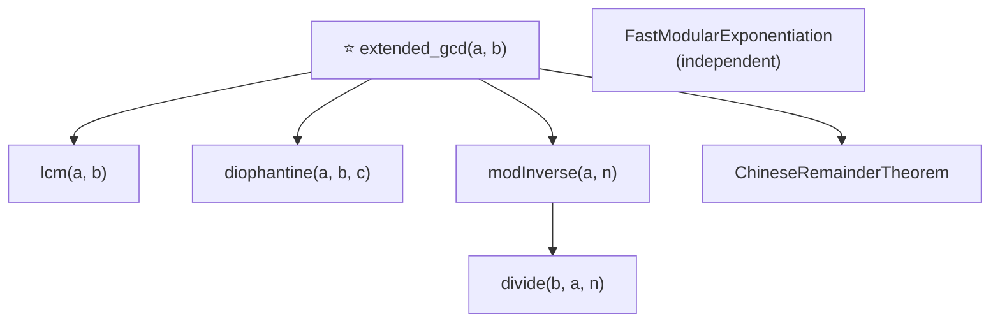

## Name : Farhad Ali
## ID :IT23035

# 🔢 Day 1 Assignment — Number Theory Algorithms

> Extended Euclid, LCM, Diophantine Equations, Modular Inverse, Fast Modular Exponentiation & Chinese Remainder Theorem — all implemented from scratch in Python.


---

## 📑 Table of Contents

1. [Overview](#-overview)
2. [Problem 1 — Extended Euclid's Algorithm](#1️⃣-problem-1--extended-euclids-algorithm-3-points)
3. [Problem 2 — Least Common Multiple](#2️⃣-problem-2--least-common-multiple-1-point)
4. [Problem 3 — Diophantine Equations](#3️⃣-problem-3--linear-diophantine-equations-3-points)
5. [Problem 4 — Modular Inverse & Division](#4️⃣-problem-4--modular-inverse--division-4-points)
6. [Problem 5 — Fast Modular Exponentiation](#5️⃣-problem-5--fast-modular-exponentiation-3-points)
7. [Problem 6 — Chinese Remainder Theorem](#6️⃣-problem-6--chinese-remainder-theorem-1-point)
8. [How Everything Connects](#-how-everything-connects)
9. [Running the Notebook](#-running-the-notebook)
10. [Summary Table](#-summary-table)

---

## 📌 Overview

| # | Problem | Function | Points |
|---|---------|----------|:------:|
| 1 | Extended Euclid's Algorithm | `extended_gcd(a, b)` | 3 |
| 2 | Least Common Multiple | `lcm(a, b)` | 1 |
| 3 | Linear Diophantine Equation | `diophantine(a, b, c)` | 3 |
| 4 | Modular Inverse & Division | `modInverse(a, n)`, `divide(b, a, n)` | 4 |
| 5 | Fast Modular Exponentiation | `FastModularExponentiation(b, e, m)` | 3 |
| 6 | Chinese Remainder Theorem | `ChineseRemainderTheorem(n1, r1, n2, r2)` | 1 |
| | **Total** | | **15** |

> ⚠️ **Note:** The assertions in the template code must **not** be removed. They act as built-in correctness checks.

---

## 1️⃣ Problem 1 — Extended Euclid's Algorithm *(3 points)*

### 📖 Problem Statement
Implement `extended_gcd(a, b)` that returns a tuple $(d, x, y)$ where

$$d = \gcd(a, b) \quad \text{and} \quad d = ax + by$$

with the constraint $a \ge b \ge 0$ and $a + b > 0$.

### 💡 Idea

**Euclid's algorithm** is based on the identity:

$$\gcd(a, b) = \gcd(b,\; a \bmod b)$$

**Extended Euclid** also tracks, at every step, how the current remainder can be written as a combination of the original $a$ and $b$.

Let the remainders be $r_0 = a,\ r_1 = b$ and

$$r_{i+1} = r_{i-1} - q_i \cdot r_i, \qquad q_i = \left\lfloor \frac{r_{i-1}}{r_i} \right\rfloor$$

If every remainder satisfies $r_i = a x_i + b y_i$, then the coefficients follow the **same recurrence**:

$$x_{i+1} = x_{i-1} - q_i x_i, \qquad y_{i+1} = y_{i-1} - q_i y_i$$

with starting values $(x_0, y_0) = (1, 0)$ and $(x_1, y_1) = (0, 1)$.

### 🖼️ Flow of the Algorithm



### 🔍 Worked Example: `extended_gcd(27, 15)`

| Step | $q$ | $r_{i}$ | $x_i$ | $y_i$ | Check: $27x + 15y$ |
|:---:|:---:|:---:|:---:|:---:|:---:|
| 0 | — | 27 | 1 | 0 | 27 |
| 1 | — | 15 | 0 | 1 | 15 |
| 2 | 1 | 12 | 1 | −1 | 27 − 15 = 12 |
| 3 | 1 | 3 | −1 | 2 | −27 + 30 = 3 |
| 4 | 4 | 0 | 5 | −9 | stop |

Result: $d = 3,\ x = -1,\ y = 2$ → $27(-1) + 15(2) = 3$ ✅

### 💻 Code

```python
def extended_gcd(a, b):
    assert a >= b and b >= 0 and a + b > 0

    d, x, y = 0, 0, 0

    old_r, r = a, b
    old_x, x = 1, 0
    old_y, y = 0, 1

    while r != 0:
        q = old_r // r
        old_r, r = r, old_r - q * r
        old_x, x = x, old_x - q * x
        old_y, y = y, old_y - q * y

    d, x, y = old_r, old_x, old_y

    assert a % d == 0 and b % d == 0
    assert d == a * x + b * y
    return (d, x, y)
```

### ✅ Output

```python
print(extended_gcd(8, 4))    # (4, 0, 1)
print(extended_gcd(27, 15))  # (3, -1, 2)
```

### 🧠 Edge Cases
- `b = 0` → loop never runs, returns `(a, 1, 0)` since $a \cdot 1 + 0 \cdot 0 = a$.
- `a == b` → one step, returns `(a, 0, 1)`.

### ⏱️ Complexity
$O(\log b)$ iterations (same as Euclid's algorithm, consecutive remainders shrink at least as fast as Fibonacci numbers in reverse — Lamé's theorem).

---

## 2️⃣ Problem 2 — Least Common Multiple *(1 point)*

### 📖 Problem Statement
Return $\text{lcm}(a, b)$ for two **positive** integers.

### 💡 Idea

$$\gcd(a, b) \times \text{lcm}(a, b) = a \times b \quad\Longrightarrow\quad \text{lcm}(a, b) = \frac{a \cdot b}{\gcd(a, b)}$$

To avoid huge intermediate values, divide first: $\text{lcm}(a,b) = \dfrac{a}{\gcd(a,b)} \cdot b$.

> `extended_gcd` requires $a \ge b$, so we pass `(max, min)`.

### 💻 Code

```python
def lcm(a, b):
    hi, lo = max(a, b), min(a, b)
    d, _, _ = extended_gcd(hi, lo)
    return a // d * b
```

### ✅ Tests

```python
assert lcm(9, 3) == 9
assert lcm(17, 37) == 629
```

---

## 3️⃣ Problem 3 — Linear Diophantine Equations *(3 points)*

### 📖 Problem Statement
Given $a > 0,\ b > 0,\ c$ (a solution is guaranteed to exist), find integers $x, y$ such that

$$ax + by = c$$

### 💡 Idea

A solution exists **iff** $\gcd(a, b) \mid c$.

1. Run extended Euclid: $a x_0 + b y_0 = g$ where $g = \gcd(a, b)$.
2. Let $k = c / g$ (an integer).
3. Multiply both sides by $k$:

$$a (x_0 k) + b (y_0 k) = g k = c$$

So a particular solution is

$$\boxed{x = x_0 \cdot \frac{c}{g}, \qquad y = y_0 \cdot \frac{c}{g}}$$

**General solution** (for reference):

$$x = x_p + \frac{b}{g}t, \qquad y = y_p - \frac{a}{g}t, \qquad t \in \mathbb{Z}$$

> Since `extended_gcd` needs $a \ge b$, if $a < b$ we swap the inputs and swap the resulting coefficients back.

### 💻 Code

```python
def diophantine(a, b, c):
    hi, lo = max(a, b), min(a, b)
    gcd, xh, yh = extended_gcd(hi, lo)

    k = c // gcd

    if a >= b:
        x, y = xh * k, yh * k
    else:                       # inputs were swapped, swap coefficients back
        x, y = yh * k, xh * k

    assert c % gcd == 0
    assert a * x + b * y == c

    return (x, y)
```

### ✅ Output

```python
print(diophantine(34, 51, 170))   # (-10, 10)  →  34(-10) + 51(10) = 170 ✔
print(diophantine(91, 117, 65))   # (20, -15)  →  91(20) + 117(-15) = 65 ✔
```

---

## 4️⃣ Problem 4 — Modular Inverse & Division *(4 points)*

### 📖 Problem Statement
Given $a, b, n$ with $\gcd(a, n) = 1$ and $n > 1$, find $x \in [0, n-1]$ such that

$$b / a \equiv x \pmod n \iff ax \equiv b \pmod n$$

### 💡 Idea

The inverse $a^{-1}$ satisfies $a \cdot a^{-1} \equiv 1 \pmod n$.

Since $\gcd(a, n) = 1$, Extended Euclid on $(n, a)$ gives

$$n \cdot x + a \cdot y = 1 \;\Longrightarrow\; a \cdot y \equiv 1 \pmod n$$

So $a^{-1} \equiv y \pmod n$. Then:

$$\boxed{\,b/a \equiv a^{-1} \cdot b \pmod n\,}$$

- We first reduce `a = a % n` so that $n \ge a$ (required by `extended_gcd`).
- `y` can be negative, so we normalize with `y % n`.

### 💻 Code

```python
def modInverse(a, n):
    """Calculate the multiplicative inverse of a (mod n)"""
    a = a % n
    d, x, y = extended_gcd(n, a)
    assert d == 1                 # inverse exists only if gcd(a, n) = 1
    return y % n


def divide(b, a, n):
    assert n > 1 and a > 0 # and gcd(a, n) == 1

    aInv = modInverse(a, n)

    assert (a * aInv) % n == 1

    # return the number x s.t. a*x = b (mod n) and 0 <= x <= n-1.
    return (aInv * b) % n
```

### ✅ Output

```python
print(divide(9, 5, 3))      # 0
print(divide(223, 67, 54))  # 13
```

**Verification**
- $5 \cdot 0 = 0 \equiv 9 \pmod 3$ ✔
- $67 \cdot 13 = 871 = 16 \cdot 54 + 7$, and $223 = 4 \cdot 54 + 7$, so both $\equiv 7 \pmod{54}$ ✔

---

## 5️⃣ Problem 5 — Fast Modular Exponentiation *(3 points)*

### 📖 Problem Statement
Compute $b^e \bmod m$ using about $2\log_2 e$ modular multiplications, **without** Python's built-in power (`**` / `pow`).

### 💡 Idea — Square and Multiply

Write $e$ in binary: $e = \sum_i e_i 2^i$. Then

$$b^e = \prod_{i \,:\, e_i = 1} b^{2^i}$$

We repeatedly **square** the base (giving $b^{2^i}$) and **multiply** it into the result whenever the current bit of $e$ is 1.

### 🖼️ Example: $4^5 \bmod 3$  ( $5 = 101_2$ )

| Bit (LSB→MSB) | base $= 4^{2^i} \bmod 3$ | bit = 1 ? | result |
|:---:|:---:|:---:|:---:|
| 1 | 1 | ✅ | $1 \cdot 1 = 1$ |
| 0 | 1 | ❌ | 1 |
| 1 | 1 | ✅ | 1 |

Final answer = **1** ✅

### 🖼️ Flow



### 💻 Code

```python
def FastModularExponentiation(b, e, m):
    result, base = 1 % m, b % m      # "1 % m" handles m = 1 correctly
    while e > 0:
        if e & 1:                    # current bit is 1 → multiply
            result = (result * base) % m
        base = (base * base) % m     # square
        e >>= 1                      # next bit
    return result
```

### ✅ Output

```python
print(FastModularExponentiation(4, 5, 3))   # 1
```

### ⏱️ Complexity
- At most $\lfloor \log_2 e \rfloor + 1$ squarings and the same number of multiplications → about $2\log_2 e$ total.
- Compare with the naive method: $e - 1$ multiplications.

| $e$ | Naive multiplications | Square-and-multiply (≤) |
|:---:|:---:|:---:|
| $10^3$ | 999 | ~20 |
| $10^6$ | 999 999 | ~40 |
| $10^{18}$ | $\approx 10^{18}$ | ~120 |

---

## 6️⃣ Problem 6 — Chinese Remainder Theorem *(1 point)*

### 📖 Problem Statement
Given coprime $n_1 > n_2$ and remainders $0 \le r_1 < n_1$, $0 \le r_2 < n_2$, return $r$ with $0 \le r < n_1 n_2$ such that

$$r \equiv r_1 \pmod{n_1}, \qquad r \equiv r_2 \pmod{n_2}$$

### 💡 Idea

Because $\gcd(n_1, n_2) = 1$, Extended Euclid gives

$$n_1 x + n_2 y = 1$$

Reading this equation modulo each modulus:

- mod $n_1$: $\;n_2 y \equiv 1$ → $n_2 y$ is $1$ mod $n_1$ and $0$ mod $n_2$
- mod $n_2$: $\;n_1 x \equiv 1$ → $n_1 x$ is $1$ mod $n_2$ and $0$ mod $n_1$

So the following works:

$$\boxed{\,r = \big(r_1 \cdot n_2 \cdot y \;+\; r_2 \cdot n_1 \cdot x\big) \bmod (n_1 n_2)\,}$$

### 🔍 Worked Example: $n_1 = 13,\ r_1 = 7,\ n_2 = 6,\ r_2 = 5$

- $\gcd(13, 6)$: $13 \cdot 1 + 6 \cdot (-2) = 1$ → $x = 1,\ y = -2$
- $r = 7 \cdot 6 \cdot (-2) + 5 \cdot 13 \cdot 1 = -84 + 65 = -19$
- $-19 \bmod 78 = 59$ ✅

Check: $59 = 4 \cdot 13 + 7$ ✔ and $59 = 9 \cdot 6 + 5$ ✔

### 💻 Code

```python
def ChineseRemainderTheorem(n1, r1, n2, r2):
    (d, x, y) = extended_gcd(n1, n2)

    assert d == 1

    return (r1 * n2 * y + r2 * n1 * x) % (n1 * n2)
```

### ✅ Output

```python
print(ChineseRemainderTheorem(13, 7, 6, 5))    # 59
print(ChineseRemainderTheorem(28, 20, 19, 3))  # 440
```

---

## 🕸️ How Everything Connects

`extended_gcd` is the **core building block**; almost every other problem reuses it.



| Problem | Uses `extended_gcd` for… |
|---|---|
| LCM | computing $\gcd(a,b)$ |
| Diophantine | the base solution $(x_0, y_0)$ of $ax+by=\gcd$ |
| Modular inverse | the coefficient $y$ in $nx + ay = 1$ |
| CRT | the Bézout coefficients of $n_1, n_2$ |

---

## ▶️ Running the Notebook

```bash
# 1. Clone / download the repo
git clone <your-repo-url>
cd <your-repo-folder>

# 2. Install Jupyter (if needed)
pip install notebook

# 3. Launch
jupyter notebook "Day 1 Assignment.ipynb"
```

Or upload the `.ipynb` file to **[Google Colab](https://colab.research.google.com)** and run all cells top to bottom.

> 🔁 Run the cells **in order** — Problems 2, 3, 4 and 6 depend on `extended_gcd` from Problem 1.

---

## 📊 Summary Table

| Function | Core Idea | Time Complexity | Sample Output |
|---|---|---|---|
| `extended_gcd` | Euclid + track Bézout coefficients | $O(\log b)$ | `(3, -1, 2)` for (27, 15) |
| `lcm` | $\frac{ab}{\gcd(a,b)}$ | $O(\log b)$ | `629` for (17, 37) |
| `diophantine` | Scale Bézout solution by $c/\gcd$ | $O(\log b)$ | `(-10, 10)` for (34, 51, 170) |
| `modInverse` / `divide` | Bézout coefficient of $(n, a)$ | $O(\log n)$ | `13` for (223, 67, 54) |
| `FastModularExponentiation` | Binary exponentiation | $O(\log e)$ | `1` for $4^5 \bmod 3$ |
| `ChineseRemainderTheorem` | $r_1 n_2 y + r_2 n_1 x \bmod n_1 n_2$ | $O(\log n_1)$ | `59`, `440` |

---

## 📚 References

- Extended Euclidean Algorithm — [Wikipedia](https://en.wikipedia.org/wiki/Extended_Euclidean_algorithm)
- Modular Exponentiation — [Wikipedia](https://en.wikipedia.org/wiki/Modular_exponentiation)
- Chinese Remainder Theorem — [Wikipedia](https://en.wikipedia.org/wiki/Chinese_remainder_theorem)
- Linear Diophantine Equation — [Wikipedia](https://en.wikipedia.org/wiki/Diophantine_equation)

---

<p align="center">Made with ❤️ for the Number Theory workshop · Day 1</p>
